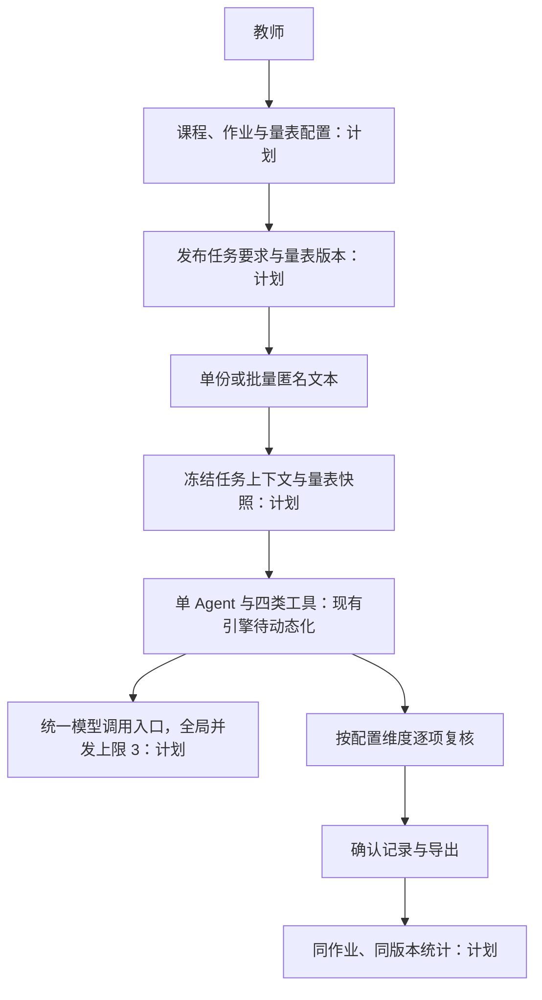

# 阅见技术设计 v2：任务与已发布量表绑定

> **2026-10-23 实施更新**：教师配置量表、动态评分、批量及确认成绩统计/导出已接入，当前实现与验收见 [implementation-v2-20261023.md](implementation-v2-20261023.md)。下文保留2026-10-20基线及当时的完成状态；两套历史预设、已合并旧批量API和新表命名的兼容调整以实施记录为准。人工参考核定与全量效果评测仍待完成。


版本：`YJ-SPEC-2.0`；2026-10-20。**设计状态：待实现。** 当前运行系统仍使用固定 A–F 量表。本文件与 `requirements-v2.md`、`master-engineering-spec-and-wbs.md` 配套，避免将未来结构描述为现状。

## 1. 总体结构与信任边界

前端继续使用 Next.js / React，后端继续使用 FastAPI、SQLite WAL、Pydantic v2；模型沿用已接入的 SenseNova `deepseek-v4-flash`，本次不因跨课程需求另引框架或微调模型。



系统指令与工具白名单属于应用控制。教师提供的量表、任务要求和参考说明是有边界的评价上下文，不能修改系统权限；学生作业是待评价数据，其指令不能覆盖评价上下文。模型提出档位、理由和取证请求；服务端确定合法维度、分值、版本、证据来源和状态转换。外部模型不得直接保存确认记录。

## 2. 领域对象与物理存储

| 对象/表 | 关键字段 | 规则 |
|---|---|---|
| `courses`，新增 | id、name、created_at | 仅课程组织信息，本轮无账号模型 |
| `rubrics`，新增 | id、title、created_at | 量表系列，版本归属于此 |
| `rubric_versions`，新增 | id、rubric_id、version_no、state、revision、body、content_hash | state 为 draft/published；每系列最多一个草稿；版本号递增；发布内容永久只读 |
| `assignments`，新增 | id、course_id、title、instructions、reference_text、rubric_version_id、state、revision、context_hash | draft/published；发布时量表必须已发布，任务要求及绑定内容随之冻结 |
| `tasks`，现有 | id、body JSON | 原文、状态、draft/review、轨迹沿用；v2 草稿使用动态维度 |
| `task_contexts`，新增 | task_id PK、assignment_id、rubric_version_id、batch_item_id?、rubric_hash、context_hash、rubric_snapshot、assignment_snapshot | 每任务仅一条，创建时同事务保存；旧任务旁路绑定默认预设，不改历史 body/records |
| `records`，现有 | id、task_id、body JSON | 确认快照不可变；v2 新记录增加完整上下文；旧记录保持原字节/结构 |
| `batches`，新增 | id、assignment_id、rubric_version_id、context_hash、name、status、created_at | 一个批次只属于一个已发布作业及量表快照 |
| `batch_items`，新增 | id、batch_id、submission_label、filename、root_task_id、current_task_id | 一份提交是一项；失败重试更新 current_task_id，历史任务仍可追溯 |

任务 API 的 v2 响应组合 tasks 与 task_contexts，不要求把现有 JSON 快照重写成多张细粒度评分表。新表有外键及必要索引；迁移脚本备份数据库后在事务中创建和回填，上下文表与默认版本使用稳定 ID，重复执行无副作用。失败回滚。不得覆盖、重新评分或重生成已确认历史记录。

## 3. 量表格式与版本生命周期

下面是**计划协议示例**，不代表已有 API。

```json
{
  "id": "rv-db-lab-v1",
  "rubric_id": "rubric-db-lab",
  "version_no": 1,
  "state": "draft",
  "revision": 1,
  "title": "数据库实验报告评分标准（示例）",
  "total_score": "100.00",
  "levels": [
    {"id": "excellent", "label": "充分达成", "percent": "100.00"},
    {"id": "basic", "label": "基本达成", "percent": "70.00"},
    {"id": "partial", "label": "部分达成", "percent": "30.00"},
    {"id": "missing", "label": "未达成", "percent": "0.00"}
  ],
  "dimensions": [
    {
      "id": "sql_correctness", "name": "SQL 正确性", "max_score": "40.00",
      "description": "按本次查询任务要求评价结果与逻辑；不能运行时提示教师核查",
      "criteria": {
        "excellent": "任务查询齐全，逻辑与给定结果说明一致，边界处理有依据",
        "basic": "主要查询和结果说明成立，存在局部边界遗漏",
        "partial": "仅部分查询可解释，关键逻辑或结果说明存在明显缺项",
        "missing": "未提供可用于评价查询正确性的内容"
      }
    },
    {
      "id": "procedure", "name": "实验过程", "max_score": "30.00",
      "description": "步骤与关键操作的可复现程度",
      "criteria": {"excellent": "环境、步骤、关键操作完整且可复现", "basic": "主流程完整，少量步骤缺说明", "partial": "步骤零散，无法据此完整复现", "missing": "未提供实验过程"}
    },
    {
      "id": "analysis", "name": "结果分析", "max_score": "20.00",
      "description": "分析是否与结果对应并解释限制",
      "criteria": {"excellent": "有结果对应、原因解释及限制分析", "basic": "分析与结果对应，解释深度不足", "partial": "主要复述现象，分析依据不足", "missing": "未提供结果分析"}
    },
    {
      "id": "writing", "name": "表达规范", "max_score": "10.00",
      "description": "结构与术语是否清楚",
      "criteria": {"excellent": "结构清楚、术语一致且引用标注完整", "basic": "整体清楚，局部格式或术语不一致", "partial": "结构或表达明显影响理解", "missing": "没有可判读的报告表达"}
    }
  ]
}
```

完整判据由教师制定。服务端只检查完整性与数值合法性，不能保证判据在教学上合理。草稿可保存尚未补齐的判据和未达 100 的合计，返回 publishable=false、字段错误和后端合计；非法类型、非有限数字和冲突 ID 仍拒绝。保存草稿使用 `expected_revision` 实现乐观锁；陈旧修订号返回 409。发布先验证 requirements-v2 §3，再计算规范 JSON 的 UTF-8 SHA-256：字段键排序、固定 JSON 分隔符、禁止 NaN/Infinity、金额/比例保留规范十进制字符串。教师正文不 trim、不做 Unicode 规范化。

发布只冻结内容，不能通过 PATCH 修改。`POST /api/v2/rubrics/{id}/versions` 从既有发布版本复制为下一版草稿；该系列已有草稿则 409。新版本保留未删除维度的 ID，新维度分配新 ID。不同版本即使维度 ID 相同也不能无条件混合统计。

作业发布要求 title、instructions 非空且绑定已发布版本。上下文哈希由冻结的课程 ID、作业标题、任务要求、参考说明、量表版本 ID 与哈希计算。后续变化复制为新作业，旧作业和旧任务保持原样。作业归属、标题与要求不再原地修改。

## 4. 创建与评分协议

v2 创建单份任务只接受 `{assignment_id, submission_label, text}`；批次接受 `{assignment_id, name, files:[{submission_label,filename,text}]}`。服务端查询已发布作业并复制快照；客户端/模型不能指定替代权重、分数或另一量表。未知字段拒绝。批次原子创建，任一文件验证失败则 422，零个子任务入库；首次限制 1–40 份，每份原文 1–20000 Unicode codepoints，非空白，整批最多 200000 codepoints，超限 413；该预算是 v2 设计值，实施时通过边界测试校准并由 `/api/v2` 配置说明给前端展示。

任务生成结果以 `dimension_id`、`level_id`、reason、evidence、needs_review 表达，顺序以快照为准。示例：

```json
{
  "input_version": "原始文本的SHA256",
  "rubric_version_id": "rv-db-lab-v1",
  "rubric_hash": "已发布量表内容SHA256",
  "context_hash": "已冻结作业上下文SHA256",
  "dimensions": [
    {"dimension_id": "sql_correctness", "level_id": "basic", "reason": "说明依据与待核查内容", "reviewed": true}
  ]
}
```

该片段仅说明单项结构；实际 review 必须包含此版本的**全部四项**。评分分值、比例和总分仅由后端返回，提交端不能自填。模型生成草稿还须提供原文证据，教师人工补评可没有引用但必须填写理由、标记来源。

四类工具保留名称和职责，移除全局 `IDS/WEIGHTS/LEVELS` 对 v2 的约束：

| 工具 | v2 行为 |
|---|---|
| read_rubric | 读取当前任务已保存快照，不读取“当前最新量表” |
| locate_evidence | 只对当前学生原文定位；返回 input_version、codepoint 区间及工具调用来源 |
| calculate_scores | 从任务快照解析全部维度与合法档位，拒绝漏项、重项、未知 ID 和比例；服务端 Decimal 计分 |
| validate_draft | 动态校验维度集合、理由、证据、输入/量表/上下文版本、工具来源及分值一致性 |

计算规则：`component = (Decimal(max_score) * Decimal(percent) / 100).quantize(Decimal('0.01'), ROUND_HALF_UP)`；先逐项量化再求和，不再对总和进行另一种舍入。v2 数值以两位十进制字符串返回；总分范围 0–100。默认 A–F 仍产生 100、70、95.5 等既有数值含义，旧 API 数值类型和字段保持兼容。前端不得通过 Number/parseFloat 在本地计分，包括量表总分提示与统计预览。

## 5. API 版本与错误契约

现有 9 条 `/api/*` 路由保持原协议和固定预设。新增能力统一使用 `/api/v2/*`，**不覆盖旧接口、不把未实现的旧规划 `/api/batch/*` 当成已有兼容承诺**。完整 25 条 v2 路由列在 master 文档；此处定义共同规则。

- 201：创建课程、量表草稿、新版本或作业草稿；202：创建异步评分或重试；200：读取、保存复核、发布、确认。
- 404：资源不存在；409：版本/状态/修订号冲突、无可导出确认记录；422：字段与量表校验错误；413：输入预算超限；503：模型配置不可用。
- v2 错误结构为 `{error:{code,message,field_errors?}}`；建议 code 包括 `RUBRIC_INVALID`、`RUBRIC_NOT_PUBLISHED`、`ASSIGNMENT_NOT_PUBLISHED`、`REVISION_CONFLICT`、`VERSION_MISMATCH`、`STATE_CONFLICT`、`MIXED_RUBRIC_VERSIONS`、`NO_CONFIRMED_RECORDS`、`INPUT_LIMIT_EXCEEDED`。旧 API 错误结构不变。
- POST 新建任务/批次使用 `Idempotency-Key`，同一键与同一规范请求返回相同 ID，同键不同请求 409；键在数据库中保存，与业务写入同事务。为避免再增主表，采用新增 `request_keys` 表，记录 scope/key/request_hash/resource_id，唯一 `(scope,key)`。该表属于基础设施，不是领域对象。客户端主动重复提交可换键，不能按原文内容自动去重。
- review 与 confirm 都核对 input_version、rubric_hash、context_hash 以及 `expected_review_revision`，防止两个页面用旧复核覆盖新结果；review 保存后返回递增 revision；confirm 的完全相同重放返回同一个 record_id。

## 6. 状态、批量与恢复

单任务状态仍为 queued → running → pending_review → confirmed；运行失败到 failed。人工接管由 failed 到 pending_review，另设 `source=manual`，不存在 `status=manual`。confirm 前所有配置维度均 reviewed=true 且理由完整，确认后只读。重试创建新任务，parent_id 保留旧任务，输入与上下文快照完全相同。

批次状态为 queued/running/completed/partial_failed/failed，由每个 batch_item 的 current_task_id 推导。`total=queued+running+pending_review+confirmed+failed`；`finished=pending_review+confirmed+failed`。completed 表示草稿处理全部结束且无失败，confirmed_count 独立统计，不能显示成“成绩全部确认”。全失败为 failed，部分失败为 partial_failed；重试后可回到 queued/running。

一次失败的批次内任务重试，须在同事务检查它仍是该 item 的 current_task 且为 failed，创建新任务、继承上下文、更新 current_task_id，提交总数不变；同一旧任务重复重试返回 409 或按同 Idempotency-Key 返回原新任务。批次创建和已排队任务恢复必须有持久化队列状态，不能把 FastAPI BackgroundTasks 视为持久化保障。

所有请求共用一个 Provider 实例和同一进程级 Semaphore(3)。锁包裹实际外部请求，包括重试的每次 HTTP 调用，退避期间释放锁。BatchRunner 另限制最多 3 个运行任务，不能替代 Provider 的统一限制。单 worker 部署；未来多进程部署必须增加共享限流器。现有 429 重试预算保留，重试不能越过任务总预算。

重启恢复采用明确的保守策略：旧 queued/running 标 failed，错误 `interrupted_by_restart`，保留输入、快照与轨迹，重算批次状态；由教师显式重试，不自动重放潜在已计费调用。模型语义和确定性工具异常分开记录。

## 7. 学情统计与 CSV

统计接口 `basis=confirmed|working`，默认 confirmed。confirmed 只取不可变确认记录；working 对未确认项优先使用已保存 review，再取有效 draft，确认项始终取 record，响应必须标 `provisional=true`。返回 submitted/analyzed/confirmed/pending/failed/excluded 等计数及每条来源，空数据返回 null 的统计值与空列表，不能伪造 0 分均值。

维度得分率由后端 Decimal 计算，3–12 维原生 SVG 雷达图、1–2 维条形展示，不能继续要求固定六轴。共性问题先用规则与高频短语聚合，保留关联匿名项和理由；不称为已经训练的语义聚类模型。不同课程、不同作业或不同量表版本不直接合并维度分数。

CSV 只导出已确认项，无确认项返回 409。列含匿名提交号、状态、量表版本、各维名称与分数、总分、确认时间；动态列顺序与快照一致；Content-Disposition 用安全生成的文件名，正文 UTF-8 BOM，使用标准 csv writer。对来自文件名/匿名号/维度名等教师或学生文本，前导空白后首字符为 `= + - @` 时加文本前缀以避免电子表格执行；分值列采用服务端十进制数字。响应头和页面明确导出与排除数，不能静默把未确认草稿当正式成绩。

## 8. 前端与迁移实施切口

计划页面：课程/作业选择；量表编辑与发布；单份工作台；批量进度；同作业诊断。任务运行与复核页面只读任务快照，不能随全局“当前量表”变化。选择草稿量表不能启动评分；预览配置时服务端校验和计算合计，前端只显示结果。

当前需要修改的固定假设至少包括：`rubric.py` 的默认配置、`models.py` 的 Literal 与长度限制、`agent.py` 提示和完成条件、`tools.py` 的维度/分值校验、`app.py` 的排序与复核、`storage.py` 的快照与迁移、`grading.ts` 类型及前端工作台循环。仅修改 rubric.py 不构成可配置实现。

先为旧 `/api/*` 留兼容适配层，再让 v2 任务通过快照工作；共享相同的确定性工具原则。集成测试必须同时覆盖旧固定预设、四维新量表、一维/十二维边界、旧任务迁移、版本升级、失败重试、混合入口并发和按确认记录导出。新增接口未实现前不得修改演示入口使其假装支持新功能。
