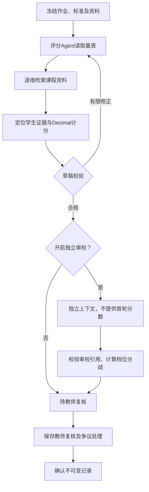

# 阅见教学增强v3：需求、设计与使用

版本YJ-LEARNING-3.0，2026-10-23。本次统一集成，不另设成员分工；旧WBS只作为历史基线。实际测试及运行证据见[验收记录](learning-acceptance-20261023.md)。

## 已实现能力与入口

| 能力 | 入口 | 行为 |
|---|---|---|
| 课程知识库 | 作业任务 → 任务设置 → 课程资料与批改策略 | 导入TXT/MD、DOCX和文本PDF，查看提取文本及原文件，替换版本、归档/恢复 |
| 检索增强 | 同上，启用按评分维度检索 | 评分Agent逐维检索冻结的资料，展示真实片段与出处，课程引用和学生证据分开 |
| 独立审校 | 同上开启，在提交与复核查看 | 同一配置模型使用独立上下文，不接收首轮评分，程序核对档位、引用并重算分数 |
| 争议复核 | 提交与复核、结果与学情 | 分歧、审校失败和高风险注入优先排序，教师记录处理说明后确认 |
| 修改稿追踪 | 提交与复核 → 审校与学习改进 | 按理由和教师下一档判据整理建议，另存修改稿，比较字符修改和后端分项分差 |
| 评测中心 | 教学评测 | 双人独立评分、人工裁定、参考冻结、四条件实验及输出证据核查 |
| 运行观测 | 结果与学情 | 模型调用、Token、费用估算、排队/执行耗时、教师改档数 |

检索与审校默认关闭，只影响保存策略之后的新提交。历史任务继续使用原流程和原快照。系统仍服务于本地教师，没有学生账号、OCR、SQL执行或自动发布成绩。PDF/DOCX摄取用于课程资料，学生答案仍为粘贴和TXT/MD。

## 数据完整与检索

原始资料字节和提取文本分别计算SHA-256。TXT/MD按UTF-8原样读取；DOCX按段落提取；文本PDF按页提取。转换文本可预览，不承诺保留PDF原排版。资料正文不可原地修改，替换产生新ID并保留旧版本。

输入限制：单文件1至2000000字节，提取文本1至100000字符；每课程最多20份在用资料、合计200000字符；PDF最多30页，加密及纯扫描资料拒绝。DOCX解包最多10MB且拒绝DTD/实体。PDF使用上下文内解压、内容流和解析工作预算。

learning_snapshot冻结课程、策略修订、资料ID与内容哈希、检索算法及快照哈希。归档或替换资料不改变旧提交。失败重试和修改稿沿用原快照。

检索是本地BM25词法检索：英文分词、中文二元组，900字符窗口、100字符重叠，优先在后半窗口换行处分段。所有片段记录Unicode codepoint的start/end/quote。查询1至1000字符，返回1至5段，无词项重叠返回空。不使用Embedding或向量数据库，不宣称语义召回已经验证。

读取量表时，后端先按每个维度执行真实检索，将course_materials和去重的material_passages一并反馈，减少逐维请求模型的往返及共享片段的重复上下文；模型仍可调用search_materials补充检索。后端保存真实查询、命中及其发起来源，供独立审校与教师核查。课程资料不能填写到学生evidence，学生引用仍须由locate_evidence定位并逐字核对原文。

## Agent与独立审校



评分角色保留四类确定性工具，开启检索时增加search_materials。每份提交仍最多24次逻辑模型调用、300秒执行预算、3次草稿校验/2轮修正。审校额外占一次逻辑调用，计入同一预算。模型实际请求仍共享进程级并发3与429退避。

Provider新增可选MODEL_MAX_OUTPUT_TOKENS（默认8192）及MODEL_MIN_REQUEST_INTERVAL_SECONDS（默认0）。低配额账号可缩小单次输出预算并设置全局请求间隔；等待计入任务300秒预算，仍不保证不触发服务方限流。默认值保留旧行为，实验记录同时保存这两项配置。

审校通过同一模型的独立消息上下文完成，不等同两位独立专家。输入只有学生文本、教师标准/任务和检索片段，排除首轮分数、档位和理由。审校须返回完整动态维度、合法档位、理由和学生原文引用；后端实际重新定位引用并以Decimal计分。

审校不能改首轮成绩。档位不同即标争议。格式错误、捏造引用、无剩余调用预算或调用失败时保留首轮合规草稿，标审校失败。整体超时终止任务，保留输入供显式重试或人工接管；人工接管同样可记录审校未完成的处理依据。

审校有分歧或失败时，教师须先保存逐项复核，再填写处理说明。说明绑定review_revision，继续修改复核后需重新记录。确认记录保存当时资料、检索、审校和处理快照，确认后不可写。未开启增强的旧确认记录格式不变。

## 修改稿与反馈

建议来自当前分项理由和教师量表的下一档判据，标明草稿或教师复核来源，不宣称生成了经教师核定的个性化学习路径。

修改稿创建新task_id和input_version，沿用匿名编号、作业、标准及资料快照。learning_revisions记录前稿、根提交和稿次，与失败重试parent_id分开；修改稿失败重试仍保留稿次。

后端以Decimal计算分项和总分变化。任一稿未确认即标临时；依据不同不比较分数。文本差异用codepoint范围，最多展示100处、每处前2000字符，完整原文保留。分数变化只说明两稿观察差异，不能解释为系统导致学习提升。

## 人工参考与四条件实验

1. 评测集限定同一次已发布作业，冻结当前课程资料。
2. 添加匿名提交，保存输入、量表及任务哈希。
3. 至少两位不同人工评阅者填写全部维度档位、依据、人工声明及可选耗时。录入上下文不含AI评分。编号规范化后须不同。
4. 人工裁定后冻结参考。系统只检查本地声明和编号，不能验证真实身份与独立性；实际评阅仍需人完成。
5. 无参考或无资料时阻止准确性实验；未裁定样本明确排除。
6. 固定模型、输入、任务、标准和资料，切换检索与审校，形成core、retrieval、core_audit、retrieval_audit四条件。在独立内存库执行，不修改原提交；保存模型配置和源文件哈希、失败、耗时、Token及费用。
7. 档位一致率分母包含全部尝试，失败计0个一致维度。平均绝对误差仅对成功结果计算，同时列出分母。输出引用是否支持结论由人工另行核查，不自动填真。单价未配置时费用为null。

审校不会自动替换首轮分数，因此不能预设其改善评分误差；应比较分歧提示、人工纠正、证据问题发现和运行开销。原v2直接提示/无最终校验/完整Agent三条件脚本保留，本次2×2实验独立报告。

测试中的评阅者、分数和人工声明均为隔离替身，不进入真实成果。真实模型演示使用合成文本、保留待教师复核，不能宣称准确率或效率提升。

## 存储与接口

原/api和31条/api/v2接口保持。新侧表：learning_documents、learning_policies、learning_runs、learning_revisions、evaluation_suites、evaluation_ballots、evaluation_references、evaluation_runs。不重写旧tasks/records，不重算旧成绩。

新增/api/v3接口：

| 路径 | 方法及要点 |
|---|---|
| /courses/{id}/materials | GET列表，POST导入title/filename/content_base64/replaces_id |
| /materials/{id} | GET提取正文，PATCH expected_revision与archived |
| /materials/{id}/file | GET原字节，服务端安全下载名 |
| /assignments/{id}/policy | GET / PUT，修订号与retrieval_enabled/audit_enabled |
| /assignments/{id}/review-queue，/metrics | GET争议排序与运行观测 |
| /tasks/{id}/learning | GET检索、审校、建议和稿次 |
| /tasks/{id}/audit-acknowledgment | POST三类版本、复核修订和note |
| /tasks/{id}/revisions | POST text与Idempotency-Key，202新提交 |
| /tasks/{id}/comparison | GET后端分差及字符修改 |
| /evaluation-suites，/evaluation-suites/{id} | POST创建，GET列表/详情 |
| /evaluation-suites/{id}/samples | POST task_id与expected_revision |
| /evaluation-suites/{id}/samples/{task}/context | GET人工录入上下文，不含AI分数 |
| 同一样本路径下/ballots，/adjudication | POST人工编号、声明、全维档位及依据 |
| /evaluation-suites/{id}/runs | POST异步真实模型实验 |
| /evaluation-runs，/evaluation-runs/{id} | GET实验历史、逐次结果 |
| /evaluation-runs/{id}/export | GET完整JSON及配置 |
| /evaluation-runs/{id}/rows/{index}/evidence-review | POST人工核查声明、supported及依据 |

错误沿用v2结构：404资源不存在，409状态/版本/幂等冲突，422非法输入或参考门禁，413资料超限，503模型未配置。未知字段与布尔冒充修订号等输入拒绝。

## 复现

```powershell
uv run --project backend pytest backend/tests
pnpm --dir frontend typecheck
pnpm --dir frontend lint
pnpm --dir frontend build --webpack
pnpm --dir frontend test:learning-e2e
uv run --project backend python backend/scripts/learning_demo.py --seed --run
uv run --project backend python backend/scripts/evaluate_learning.py --suite <评测集ID> --check
```

浏览器测试须启动backend/tests/ui_server.py并选独立TEST_DB_PATH；前端E2E_BASE_URL指向该测试前端，可用PLAYWRIGHT_CHROME_PATH选择本机已安装浏览器。禁止连接正式模型或真实Demo数据库。

新增pypdf 6.21.2，依据[官方文档](https://pypdf.readthedocs.io/en/stable/user/extract-text.html)实现文本PDF提取。Next.js与eslint-config-next升级16.4.1，依据[安全公告](https://github.com/advisories/GHSA-673q-mjm6-r5xr)。shadcn仅用于组件生成和编译样式，移至开发依赖。生产依赖审计通过，开发依赖仍有尚无已发布补丁的braces公告，需后续跟踪，不宣称全部开发依赖无风险。
