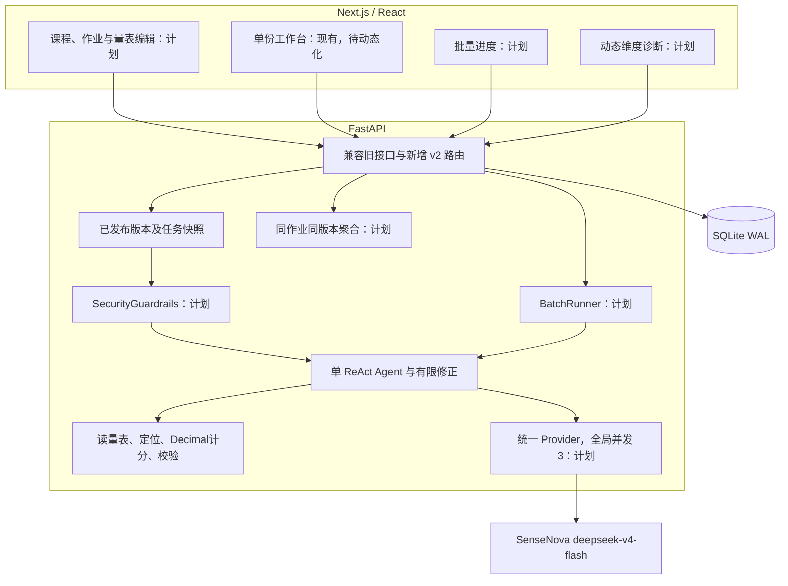

# 阅见：工程规范与五人任务分解 v2

> **教学增强v3（2026-10-23）**：新增课程资料BM25检索、独立审校与争议处理、修改稿对比、人工参考门禁及四条件实验。当前接口、数据模型和验收统一见[教学增强v3规范](learning-workflow-v3.md)。本次统一实施，不另设成员分工；下文人员WBS与v2计划表保留为历史基线，不能据其“待实现”文字判断当前状态。已实现、真实试运行及待人工验证分别见[本轮验收记录](learning-acceptance-20261023.md)。

> **统一工作台补充（2026-10-23）**：首页与`/v2`统一为“作业任务”；任务内分“任务设置、提交与复核、结果与学情”，评分标准库独立管理。旧工作台保留在`/legacy`。现有31条v2路由包含只读提交索引；当前组件路径、操作与验收见[统一工作台记录](unified-workspace-20261023.md)，下文25条接口为10月20日原设计清单。

> **2026-10-23 实施更新**：教师配置量表、动态评分、批量及确认成绩统计/导出已接入，当前实现与验收见 [implementation-v2-20261023.md](implementation-v2-20261023.md)。下文保留2026-10-20基线及当时的完成状态；两套历史预设、已合并旧批量API和新表命名的兼容调整以实施记录为准。人工参考核定与全量效果评测仍待完成。


**版本 `YJ-SPEC-2.0`；修订日期 2026-10-20；性质：后续迭代设计，尚未实现。**

本版根据项目负责人新增目标修订：最终支持其他课程的文本作业，由教师配置评分标准。在原“单份批改扩展批量与班级诊断”的方案上，先补齐课程/作业上下文、量表配置与版本、动态评分引擎，再做批量和统计。本文不是任课教师正式下发的期末任务书，不据此宣称已完成全部目标。

仓库规范源文件为 `docs/master-engineering-spec-and-wbs.md`；Brain 同名文件是同步副本。分发时同时提供 `requirements-v2.md` 和 `architecture-v2.md`，三个文件必须保持 `YJ-SPEC-2.0` 一致。原版备份在 `docs/coordination/archive/master-engineering-spec-and-wbs.pre-v2-20261020.md`，仅供追溯，禁止当新任务依据。

## 本次变化与完成边界

| 项目 | 旧计划 | 本版确定的方向 |
|---|---|---|
| 使用场景 | 固定 A–F 任务单批量评分 | 教师配置标准的跨课程文本作业辅助批改 |
| 配置流程 | 读取固定量表 | 建课程、建量表草稿、发布版本、建作业并绑定版本 |
| 维度 | 固定六项 | 1–12 项，按快照动态取证、计分、复核、统计和导出 |
| 历史规则 | 仅版本字符串 | 已发布内容不可变，任务保存量表与作业快照和哈希 |
| 接口 | 9 条现有接口，加 5 条拟新增批次接口 | 9 条现有接口保持；25 条拟新增 `/api/v2/*` 接口 |
| 文件 | TXT/MD、DOCX、ZIP 表述不一致 | 本轮承诺 UTF-8 TXT/MD 和粘贴；其余格式排除 |
| 雷达图 | 固定六轴 | 3–12 轴动态雷达，1–2 维用条形展示 |
| 导出与统计 | 草稿/复核/确认口径不够明确 | 默认确认结果；临时预览显著标识；CSV 只含已确认项 |
| 基准 | 15–20/20 份表述混用，含预设提升数字 | 计划 36 份、三类课程；先人工核定，实测后填写结果 |
| 性能 | 40 份 300 秒、成功率 100% | 全局模型并发不超过 3；吞吐、失败与 429 单独实测 |

**已实现事实：**单份匿名文本、固定 A–F、四类工具、证据定位、Decimal 算分、最多两轮修正、教师六维复核、确认归档、JSON 导出、失败重试与人工接管。现有物理表为 tasks/records。2026-10-19 后端测试 92/92；2026-10-16 同模型 S1=100、S2=70，均是匿名合成样本的待教师核定草稿。

**待实现：**本文新增课程/作业/量表能力、动态引擎、统一并发锁、批次、学情、CSV、安全扫描和跨课程评测。不得把本文类名、示例响应或 AI 提示词当成已经存在的代码。

# 第一部分：范围、架构与状态

## 1.1 产品范围

教师在本机建立课程与作业，提供任务要求及可选参考说明，配置并发布评分量表，再提交单份或批量匿名文本。AI 提供逐项档位、理由、原文证据与核查事项，教师逐项复核并明确确认，系统保存可追溯记录并统计同次作业情况。

课程论文、实验报告、论述题是适用场景示例，目前并无跨课程真实评分验证。本轮无扫描件/OCR、数学推导验证、代码自动执行、学生门户、多教师权限、抄袭判定、正式成绩发布和教务对接。输入先支持 UTF-8 TXT/MD 与粘贴。

功能编号：FR-01 单份辅助批改；FR-02 批量；FR-03 同作业学情；FR-04 确认成绩 CSV；FR-05 课程与作业；FR-06 量表配置与版本；FR-07 注入告警。完整验收见 `requirements-v2.md`，涉及历史范围的 `requirements.md` 继续作为回归基线。

## 1.2 架构



每份作业独立调用同一个 Agent 引擎，批量并行不等于多角色智能体协作。本轮不引入 RAG、LangGraph 或模型微调。跨课程主要依赖任务要求与教师量表，而非自动猜测课程和标准。

## 1.3 固定不变的原则

- 接收原文立即生成 UTF-8 SHA-256；原文、空格、换行和 Unicode 原样保留。
- 学生指令是被评价数据，不能覆盖系统、量表或工具权限。任务要求和参考答案不能冒充学生原文证据。
- 所有计分与预览由后端 `Toolbox.calculate_scores` 基于快照和 Decimal 完成；前端不自行做分数加减或猜分。
- 引用使用 Unicode codepoint 左闭右开偏移，逐字比对并核对定位工具来源；文字存在不自动证明语义支持评分。
- AI 只生成待复核草稿；确认须所有配置维度复核且理由完整；确认后只读。
- 所有外部模型请求统一进入进程级 Semaphore(3)，包含单份、批量与重试；单 worker 部署。
- 既有 92 个测试全部保持通过；新增能力有对应测试与真实运行记录后才标实现。

## 1.4 状态与完成含义

单任务状态沿用 queued/running/pending_review/failed/confirmed。人工接管到 pending_review，另记录 `source=manual`，**不新增 `status=manual`**。首次草稿校验失败最多修正 2 轮、总共最多 3 次校验，另有 24 次模型请求和 300 秒运行预算；排队耗时单列。

重试只允许 failed，创建 parent_id 关联的新任务，复制原文和全部上下文；旧任务保留。confirmed 写操作返回 409，相同确认重放返回同一记录。

批次 queued/running/completed/partial_failed/failed，由每个提交的当前任务推导。completed 仅指全部草稿运行完且无失败，教师确认数独立展示。总数分解为 queued+running+pending_review+confirmed+failed，finished 为 pending_review+confirmed+failed。

失败重试更新 batch_item.current_task_id，不新增提交项，不增加 total；保留 root_task_id 与任务链。服务重启把未完成任务标失败、保留快照并重算批次，由教师显式重试，不自动重复模型调用。

# 第二部分：数据与评分配置契约

## 2.1 数据模型

| 实体/表 | 核心字段 | 约束 |
|---|---|---|
| courses，新 | id/name/created_at | 课程组织，不承担账号与授权 |
| rubrics，新 | id/title/created_at | 一组有版本的评分标准 |
| rubric_versions，新 | id/rubric_id/version_no/state/revision/body/content_hash | draft/published；每系列最多一份草稿；已发布不可改 |
| assignments，新 | id/course_id/title/instructions/reference_text/rubric_version_id/state/revision/context_hash | 发布前绑定已发布量表，发布后任务上下文不可改 |
| tasks，现有 | id/body JSON | 原文、状态、草稿、复核、执行摘要；v2 动态维度 |
| task_contexts，新 | task_id/assignment_id/rubric_version_id/batch_item_id?/rubric_hash/context_hash/两个 snapshot | 一任务一份不可变上下文；迁移旧任务不改原 body |
| records，现有 | id/task_id/body JSON | 旧记录不改；v2 新确认快照附完整上下文 |
| batches，新 | id/name/assignment_id/rubric_version_id/context_hash/status/created_at | 同次作业、同一上下文与版本 |
| batch_items，新 | id/batch_id/submission_label/filename/root_task_id/current_task_id | 每份提交唯一，重试不增加提交数 |
| request_keys，新基础设施 | scope/key/request_hash/resource_id | 幂等键与业务资源同事务落库 |

原 tasks/records 物理结构不必重写。新增关系与索引用新表承载；迁移须备份、事务回滚、幂等执行，旧确认记录不得重新生成或改写。默认预设以稳定标识保存为已发布快照，旧任务通过 task_contexts 绑定默认快照。

## 2.2 量表结构

每份已发布量表：1–12 个有稳定 ID 的维度，满分为十进制字符串、各项大于 0 且合计 100.00；统一 2–8 个档位，每档有稳定 ID、标签、0–100 的比例，比例最多两位小数且互不重复，包含 0 和 100；每维每档判据非空。

示意：

```json
{
  "rubric_id": "rubric-db-lab",
  "id": "rv-db-lab-v1",
  "version_no": 1,
  "state": "published",
  "total_score": "100.00",
  "levels": [
    {"id":"excellent","label":"充分达成","percent":"100.00"},
    {"id":"basic","label":"基本达成","percent":"70.00"},
    {"id":"partial","label":"部分达成","percent":"30.00"},
    {"id":"missing","label":"未达成","percent":"0.00"}
  ],
  "dimensions": [
    {"id":"sql_correctness","name":"SQL正确性","max_score":"40.00","description":"依据本次查询任务评价","criteria":{"excellent":"查询与结果说明完整一致","basic":"主要查询成立，边界略缺","partial":"关键逻辑或说明不足","missing":"未提供可评价内容"}},
    {"id":"procedure","name":"实验过程","max_score":"30.00","description":"步骤可复现性","criteria":{"excellent":"环境步骤完整可复现","basic":"主流程完整，局部略缺","partial":"步骤零散难以复现","missing":"无实验过程"}},
    {"id":"analysis","name":"结果分析","max_score":"20.00","description":"结果依据与限制","criteria":{"excellent":"解释结果及限制","basic":"对应结果但解释不足","partial":"主要复述现象","missing":"无结果分析"}},
    {"id":"writing","name":"表达规范","max_score":"10.00","description":"结构与术语","criteria":{"excellent":"结构清楚术语一致","basic":"整体清楚局部不一致","partial":"表达影响理解","missing":"无可判读表达"}}
  ],
  "content_hash": "发布时由服务端计算"
}
```

示例不是正式数据库课程标准，不表示支持执行 SQL。教师确认标准后才能发布和用于真实评价。旧 A–F 作为预设保留：版本 `af-2026-10-09-v1`，权重 **15/20/30/15/10/10**，不再使用旧手册错误的 B=25、C=25 示例。

草稿允许保存尚未补齐的判据或未达 100 的合计，但返回 `publishable=false`、逐字段错误和后端计算合计；类型、ID 冲突、非有限数字等结构错误仍拒绝。发布执行全部校验，合计与判据不合规返回 422，不产生发布版本。

修改已发布规则必须复制成下一版本草稿。PATCH 草稿提交 expected_revision，旧修订号 409。发布保存规范 JSON SHA-256：键排序、固定分隔、禁止非有限值、数值字符串规范化；教师文本原样保存。任务原文哈希单独计算，不能与量表哈希混用。

## 2.3 作业与评分规则

作业包含课程 ID、标题、任务要求、可选参考说明及 rubric_version_id。发布时验证量表已发布，冻结所有上下文并生成 context_hash；发布后不原地修改，变化时复制新建作业。任务由服务端查绑定版本，不能采信客户端传来的权重或另一版本。

分项 = Decimal(满分) × Decimal(档位百分比) ÷ 100，逐项 ROUND_HALF_UP 至两位小数，再以 Decimal 求和。v2 返回两位十进制字符串，前端展示；旧 API 字段与数值类型保持兼容。动态维度按快照顺序排列，不能按 A–F 常量排序；确认检查集合完全相等，非“必须六项”。

v2 review 输入：

```json
{
  "input_version":"原文SHA256",
  "rubric_hash":"本任务量表SHA256",
  "context_hash":"本任务上下文SHA256",
  "expected_review_revision":0,
  "dimensions":[
    {"dimension_id":"sql_correctness","level_id":"basic","reason":"主要查询有说明，边界需补充","reviewed":true},
    {"dimension_id":"procedure","level_id":"excellent","reason":"步骤完整","reviewed":true},
    {"dimension_id":"analysis","level_id":"basic","reason":"缺限制解释","reviewed":true},
    {"dimension_id":"writing","level_id":"excellent","reason":"结构清楚","reviewed":true}
  ]
}
```

此例服务端返回分项 28.00/30.00/14.00/10.00，总分 82.00。模型或客户端自填分值拒绝。人工改档后需重新确认该维复核状态。confirm 同样核对三个版本值及 expected_review_revision，原子保存快照。

# 第三部分：REST API 契约

## 3.1 当前 9 条接口，保持兼容

| 方法 | 路径 | 当前行为 |
|---|---|---|
| GET | /api/health | 服务与模型配置状态 |
| GET | /api/rubric | 原固定 A–F 量表 |
| POST | /api/tasks | 原 `{text,rubric_version}`，202 |
| GET | /api/tasks/{task_id} | 原任务与状态 |
| PATCH | /api/tasks/{task_id}/review | 原六维复核，后端重算 |
| POST | /api/tasks/{task_id}/confirm | 原确认归档 |
| GET | /api/tasks/{task_id}/export | 原确认记录 JSON |
| POST | /api/tasks/{task_id}/retry | 原失败关联重试，202 |
| POST | /api/tasks/{task_id}/manual | 原失败人工接管 |

旧错误响应和默认 rubric_version 不改。旧 API 继续拒绝非默认标准；新配置功能用 v2，不能通过悄悄放宽旧接口破坏原测试。

## 3.2 新增 25 条 v2 接口，全部计划中

下表中的 `{id}` 按资源类型解释，真实实现采用明确参数名。列表默认 limit=20，范围 1–100；offset>=0，返回 items/total/limit/offset。单任务读取返回 text/input_version、三类上下文标识与快照、status、draft/review/record、trace 和错误。列表不返回原文与全量轨迹。

| 编号 | 方法与路径 | 请求/结果要点 |
|---|---|---|
| V2-01 | POST /api/v2/courses | `{name}`；201 课程 |
| V2-02 | GET /api/v2/courses | 分页课程列表 |
| V2-03 | POST /api/v2/rubrics | `{title,source_version_id?}`；201 系列及初始 draft |
| V2-04 | GET /api/v2/rubrics | 分页系列，含版本摘要和草稿 ID |
| V2-05 | POST /api/v2/rubrics/{id}/versions | `{source_version_id}` 必须是本系列发布版；201 下一 draft；已有草稿 409 |
| V2-06 | GET /api/v2/rubric-versions/{id} | 定义、state、revision、hash（发布后）、publishable 与校验信息 |
| V2-07 | PATCH /api/v2/rubric-versions/{id} | `{expected_revision,definition}`；仅 draft，返回服务端合计与发布校验 |
| V2-08 | POST /api/v2/rubric-versions/{id}/publish | `{expected_revision}`；校验后返回不可变版本；已发布同修订重放返回该版 |
| V2-09 | POST /api/v2/assignments | `{course_id,title,instructions,reference_text?,rubric_version_id}`；201 draft |
| V2-10 | GET /api/v2/assignments | 按 course_id 筛选分页 |
| V2-11 | GET /api/v2/assignments/{id} | 作业、绑定版本摘要、state/revision/context_hash |
| V2-12 | PATCH /api/v2/assignments/{id} | `{expected_revision,title,instructions,reference_text,rubric_version_id}`；仅 draft |
| V2-13 | POST /api/v2/assignments/{id}/publish | `{expected_revision}`；冻结任务上下文 |
| V2-14 | POST /api/v2/tasks | `{assignment_id,submission_label,text}`；202；服务端保存快照 |
| V2-15 | GET /api/v2/tasks/{id} | 查询动态评分任务及快照 |
| V2-16 | PATCH /api/v2/tasks/{id}/review | §2.3 请求；返回后端分项、总分、新 revision |
| V2-17 | POST /api/v2/tasks/{id}/confirm | `{input_version,rubric_hash,context_hash,expected_review_revision}`；200 唯一确认记录 |
| V2-18 | GET /api/v2/tasks/{id}/export | 已确认 JSON，含上下文，未确认 409 |
| V2-19 | POST /api/v2/tasks/{id}/retry | 202 新关联任务，批次内原子更新 current_task |
| V2-20 | POST /api/v2/tasks/{id}/manual | failed 转 pending_review，保留失败轨迹与快照 |
| V2-21 | POST /api/v2/batches | `{assignment_id,name,files:[{submission_label,filename,text}]}`；原子创建，202 |
| V2-22 | GET /api/v2/batches/{id} | 批次状态、各状态数、confirmed_count、items 的当前任务与简要结果 |
| V2-23 | GET /api/v2/batches/{id}/analytics | `basis=confirmed` 默认，可选 working；来源与临时标识必须返回 |
| V2-24 | GET /api/v2/batches/{id}/export-csv | 只导出已确认项，BOM、动态列和排除计数；无确认 409 |
| V2-25 | GET /api/v2/batches | 按 assignment_id 筛选分页历史批次 |

旧手册 `/api/batch/tasks`、`/api/batch/{id}` 等尚未实现，本版统一为上述 v2 复数路径，不要求维护不存在的旧批次接口。前端与脚本必须同版更新。

### 共同校验

- 默认新任务上限 20000 codepoints，批次 1–40 项、整批最多 200000 codepoints；空白文本 422、超限 413；文件名只是显示信息，不访问上传者文件路径。
- 新建任务、批次和重试必须带 Idempotency-Key。相同键相同请求返回同一资源，不同请求 409；键、请求哈希与资源同事务保存。其他创建资源可先不承诺幂等键。
- 404 资源不存在；409 已发布不可写、状态不符、旧 revision/版本不符；422 配置或字段无效；413 输入超限；503 模型未配置。
- v2 错误体 `{error:{code,message,field_errors?}}`。至少覆盖 RUBRIC_INVALID、RUBRIC_NOT_PUBLISHED、ASSIGNMENT_NOT_PUBLISHED、REVISION_CONFLICT、VERSION_MISMATCH、STATE_CONFLICT、MIXED_RUBRIC_VERSIONS、NO_CONFIRMED_RECORDS、INPUT_LIMIT_EXCEEDED。
- GET 统计空数据用 null/空列表及计数，不假造均分 0；JSON 禁止 NaN/Infinity。

统计返回示意：

```json
{
  "batch_id":"batch-1", "assignment_id":"assignment-db-1",
  "rubric_version_id":"rv-db-lab-v1", "basis":"confirmed", "provisional":false,
  "counts":{"submitted":10,"analyzed":7,"confirmed":7,"pending":2,"failed":1,"excluded":3},
  "thresholds":{"pass":"60.00","excellent":"90.00"},
  "summary":{"average_score":"82.00","pass_rate":"1.0000","max_score":"94.00","min_score":"70.00"},
  "dimensions":[{"dimension_id":"sql_correctness","name":"SQL正确性","max_score":"40.00","average_score":"32.00","scoring_rate":"0.8000"}],
  "common_weaknesses":[], "security_alerts":[]
}
```

这是结构示意，不是实验数据，实际 dimensions 必须包含该版本全部维度。working 模式优先 record，再已保存 review，再有效 draft，逐条标来源并设置 provisional=true；禁止把临时统计展示为确认成绩。默认及格/优秀阈值 60/90 为分析配置，须在响应中显式返回，避免误作跨课程教学结论。

# 第四部分：内部模块契约与验收

## 4.1 配置、存储与迁移

计划新增 `schemas_v2.py`、`rubric_service.py`、`migration.py`、`api_v2.py`，保留 `rubric.py` 默认预设和旧模型兼容层。具体拆文件可调整，但接口归属与验收不变。

Store/服务层至少提供：create/list_course；create/list_rubric；clone/get/save/publish_rubric_version；create/list/get/save/publish_assignment；create_task_with_context；create_batch；get/list_batch；retry_batch_item；save_review_v2；confirm_v2；export_batch_csv；recover_interrupted_v2。

新建评分任务须在一个事务中保存原文、输入哈希、上下文及幂等键。批次先一次性验证全部文件，再在一事务写入批次、提交项、任务及快照。事务中调用帮助函数不得重复 BEGIN；使用同一事务连接或明确事务上下文。

## 4.2 动态 Agent 与确定性工具

AgentRunner 从 task_contexts 读取快照；提示模板、分析清单、完成条件和复核约束按实际维度产生。四类工具名称保持，参数由任务快照核定。禁止读“最新量表”替换正在运行的任务标准。

`Toolbox.calculate_scores` 验证维度 ID 集合完全相等、档位存在、理由合法，再计算；输出由后端生成。`validate_draft` 继续核对原文、量表、上下文、工具来源、逐字证据、档位与数值。教师无需提供学生原文中不存在的“缺失证据”，但缺失理由必须明确；语义争议标人工核查。

## 4.3 批量队列与 Provider

BatchRunner 限制最多三个运行任务，单项失败继续其他项。Provider 统一实际 HTTP 请求 Semaphore(3)，单份和重试也必须经过；退避期间释放锁。测试混合入口峰值<=3、异常释放、重启恢复及批次重试计数。

300 秒是每任务运行停止预算，不是每批 40 份完成 SLA。记录 queue_wait/run_duration/retry_count/429_count，先在 10/40 份批次实测，再讨论优化。部署固定一个后端 worker；若更改进程数，先补共享并发控制。

## 4.4 安全护栏与学情

SecurityGuardrails 用规则扫描可疑指令，返回 safe/risk_level/patterns/warning_message，标 needs_review。检测不等于完全免疫注入，命中不自动扣分或判零。

ClassAnalyticsEngine 接受同作业同版本的任务上下文与评分来源，计算确认或临时统计。共性薄弱项先采用低档位及高频问题短语计数，返回 TOP3、涉及匿名项和理由来源。不要声称已训练语义聚类模型，不把课程维度当学生永久画像。

CSV 使用标准 writer、UTF-8 BOM，动态列来自绑定快照，只包含确认记录；防公式样式文本执行，正确处理逗号、引号与换行。响应头和界面显示确认导出数量与排除数量。

## 4.5 前端

新增教师配置入口，支持课程/作业选择、量表编辑、发布与复制新版本；单份工作台按快照渲染维度及档位，教师不能在已运行任务内改标准。批量上传接受同一作业的 TXT/MD，多文件解析为原文，轮询进度；不得把解析后的换行另作标准化。

诊断页按版本动态绘制 3–12 轴原生 SVG，1–2 项展示条形图；图表展示后端得分率。状态区分 AI 处理完成和教师确认完成。前端只显示服务端计算的分数及量表合计，禁止浮点估算。

# 第五部分：五人 WBS 与依赖

下表是后续责任安排，不代表成员已经完成这些代码；实际个人贡献按提交、评审与验收记录填写。

| 负责人 | 核心责任 | 计划文件/交付物 | 验收重点 |
|---|---|---|---|
| 杨峥 | 需求与接口基线、依赖协调、集成和汇报 | requirements-v2、architecture-v2、本文、验收矩阵、PPT/讲稿 | 同版契约、已做/计划清晰、模块联调可复现 |
| 刘韫恺 | 配置存储与 API、兼容迁移、批量与导出、部署 | storage.py、rubric_service.py、migration.py、api_v2.py、batch.py、CSV、Docker | 事务、旧记录不变、版本只读、幂等与重试计数、确认导出 |
| 王艺臻 | 教师配置页面、动态工作台、批量与诊断前端 | rubric-editor.tsx、assignment-manager.tsx、grading-workspace.tsx、grading.ts、batch-uploader.tsx、class-dashboard.tsx | 任意合法维度/档位、发布状态、1–2/3–12 维展示、后端计分 |
| 张呦呦 | 动态引擎/工具、安全告警与共性问题分析 | agent.py、tools.py、schemas_v2.py（与刘协商）、guardrails.py、clustering.py、provider.py | 无 A–F 硬编码、版本/证据校验、统一请求并发、告警不代替评分 |
| 胡梦杰 | 兼容/迁移/配置/并发测试、三课程基准、对比实验 | tests、新 benchmark 36 份、ablation_study.py、eval-report.md | 独立人工参考、全部条件公平、失败分母、无预设结论 |

### 5.1 杨峥：基线与集成

- [ ] 冻结 `YJ-SPEC-2.0`，组织成员核对 25 条 v2 接口、字段与错误码；后续更改写决策记录再通知依赖方。
- [ ] 确认另外两类课程的任务说明与教师判据来源；不能用自动生成量表直接冒充教师标准。
- [ ] M1 先验收四维单份、默认 A–F 回归及版本升级；再允许批量/统计接入。
- [ ] 汇报与答辩逐项区分设计、程序测试、真实模型记录和教师核定，不把责任分工当历史贡献。

### 5.2 刘韫恺：后端业务与持久化

- [ ] 从现有 Store 事务方式入手，加新表、索引、默认快照和幂等迁移；备份/回滚，不改旧记录。
- [ ] 实现课程/量表/作业 API 与发布、乐观锁；与张呦呦共同确认动态 schema 和分数协议。
- [ ] 同事务创建任务上下文；旧 API 固定预设兼容，v2 服务端绑定版本。
- [ ] 实现 BatchRunner、batch_items 重试和恢复、状态汇总；与张呦呦共享统一 Provider 限流入口。
- [ ] 动态确认成绩 CSV、部分确认计数、输入预算、幂等键、异常隔离测试。
- [ ] 最后增加单 worker Docker 部署和数据卷；先交 M1，不以部署工作替代核心配置功能。

### 5.3 王艺臻：教师配置与动态交互

- [ ] 先按 v2 协议实现课程/作业选择、量表编辑、服务端合计校验、发布与复制版本；设计示意与实际可用页面分开标识。
- [ ] 改造 grading.ts 固定联合类型和工作台六项循环，读取当前任务快照，逐项复核全部配置维度。
- [ ] 明确已发布只读、旧 revision 冲突提示及新版本不影响旧任务；保留输入不丢失。
- [ ] 再做同作业多文件进度、失败恢复和确认数展示；正确区别 completed 与 confirmed。
- [ ] 动态图表和统计 basis 标识，1–2 项不用退化雷达图；前端不本地计分。
- [ ] 修改 Next.js 代码前阅读 frontend/AGENTS.md 及仓库安装版本文档，按项目构建门禁验证。

### 5.4 张呦呦：动态工具与安全分析

- [ ] 找出 Agent、Toolbox、Pydantic 和排序中的固定 A–F/四档假设，设计旧适配与 v2 快照输入。
- [ ] 动态合法集合、逐项 Decimal 舍入、工具来源与三个哈希校验；不让教师参考说明成为学生证据。
- [ ] Provider 所有外部请求共享 Semaphore(3)，退避释放锁；与刘韫恺做单份+批量+重试混合测试。
- [ ] Guardrails 告警与正常/对抗样本，评分不因命中直接判零；记录误报与漏检。
- [ ] Analytics 明确确认/临时来源、动态维度、空数据与不同版本拒绝；共性问题有可追溯理由。
- [ ] Token 以服务实际 usage 为准，缺失写 unavailable；没有经确认价格配置不自动推算金额。

### 5.5 胡梦杰：质量与效果评测

- [ ] 先固定现有 92 项回归，补四维、一维、十二维、非法配置、旧 revision、已发布不可改测试。
- [ ] 迁移前后旧任务/记录、版本升级、重启、故障、并发峰值、批次重试计数与 CSV 转义/公式防护测试。
- [ ] 计划三类课程各 12 份，共 36 份；注明来源、合成标记、作业和量表版本、原文哈希。
- [ ] 先两位人工独立核定与分歧裁定；未核定样本不进入评分准确性统计。注入样本不预设低分真值。
- [ ] 三条件：直接提示；工具无校验；完整系统。固定模型/参数/输入/规则，保存原始输出、失败与成本。
- [ ] 按课程报告档位一致率、总分误差、逐字引用、人工证据支持、格式、成功率、耗时和 usage；未运行填“未测”。
- [ ] 删除旧文案中 28.5%、32%→0% 等预写提升数字；不把结构检查通过率当评分准确率。

## 5.6 里程碑与交接顺序

| 阶段 | 前置与目标 | 出口条件 |
|---|---|---|
| M1 可配置单份 | 杨冻结契约；刘建配置/迁移；张改动态引擎；王接配置与工作台；胡跟进回归 | 默认预设兼容；四维作业可发布、评分、复核、确认；版本升级不改旧记录 |
| M2 跨课程核定 | M1 可运行；确认另外两类作业与人工判据 | 三课程样本与参考可追溯；先暴露量表歧义，不声称泛化已成功 |
| M3 批量与分析 | M1 类型/快照稳定；统一 Provider 入口 | 受控并发、失败重试、动态图表、确认成绩导出与恢复通过 |
| M4 评测与交付 | M2 参考冻结、M3 集成可复现 | 完成三条件实测，报告失败与局限，回归及约 10 分钟演示 |

本版使用依赖顺序，不虚构统一开工日期或已完成甘特进度。负责人按实际课程截止时间另填排期。任何模块接口变更先更新此基线和对应测试，再同步依赖成员。

# 第六部分：成员 AI 编程交接提示词

以下提示词供组员后续主动使用；本文更新不意味着已执行这些开发任务。每份提示词执行前先读仓库 AGENTS.md、`requirements-v2.md`、`architecture-v2.md`、本文；保留工作区已有改动，不擅自重置。不得编造真实模型结果、人工核定或个人贡献。

## Prompt 1：杨峥

你负责阅见 v2 的需求、接口与集成。目标是教师配置量表的跨课程文本辅助批改，范围限本地单教师、TXT/MD/粘贴。先核对 YJ-SPEC-2.0 三份文档，组织接口差异与依赖清单，以 M1 可配置单份为首个出口。跟踪量表发布与快照、旧 API 兼容、数据迁移、统一模型并发、确认导出和人工参考。汇报只展示真实已完成结果；将计划、测试、模型运行和教师核定分开。先形成可评审契约和验收矩阵，按提交与验收记录填写成员贡献，不预设实验数字。

## Prompt 2：刘韫恺

你负责阅见 v2 存储、配置 API、批量与导出。按本文 25 条 /api/v2 路由实现，9 条旧接口保持兼容。先实现课程、量表草稿/发布版本、作业发布绑定、task_contexts 与幂等迁移，旧 records 不改。发布内容只读，expected_revision 旧值 409；服务端查作业绑定而非信任客户端规则。与张呦呦对齐 schemas_v2、动态 Toolbox、Provider 单实例。M1 验收四维单份和默认预设后，再做 batch_items/current_task 重试、状态汇总、确认项 CSV、恢复和部署。事务不得嵌套 BEGIN；模型调用不放数据库事务里；全局并发 3 不靠每批各自的锁冒充。新增针对性测试并保证既有 92 项通过。

## Prompt 3：王艺臻

你负责教师配置与动态前端，先读 frontend/AGENTS.md 及已安装 Next.js 文档。新增课程/作业选择、rubric-editor、发布/复制版本；按 v2 快照渲染维度和档位，不硬编码 A–F、四档或六条。所有分数、配置合计及图表得分率由后端返回，前端不估算。已发布版本只读，旧 revision 冲突应保留编辑内容并引导重载。M1 跑通四维单份复核确认后，再接 TXT/MD 批量进度与诊断；3–12 维原生 SVG、1–2 维条形，明确临时统计和确认成绩。不得用静态假页面声称配置已可运行，截图必须说明实际或设计。

## Prompt 4：张呦呦

你负责动态 Agent/Toolbox、统一 Provider、安全和学情。保留默认 A–F 与旧测试；v2 从任务快照读取维度、档位和判据，模型不能自定分数。所有计算在 Toolbox.calculate_scores 用 Decimal，逐项 ROUND_HALF_UP 两位再求和；证据只来自学生原文、codepoint 区间逐字匹配并保留定位来源，核对输入/量表/上下文。所有实际外部请求共享进程 Semaphore(3)，重试同入口、退避释放锁。先交动态单份，再做正则告警和同作业同版本统计；告警不自动判零，聚合不冒充训练的语义模型。和刘协调共享 schema/Provider 所有权，用混合入口测试峰值与异常释放。

## Prompt 5：胡梦杰

你负责回归、跨课程样本与三条件实验。先运行现有 92 项并保存基线；验证动态配置、四维/一维/十二维、版本冻结、迁移、并发和 CSV。计划三类课程各 12 份共 36 份，明确来源和合成标记，冻结作业要求/量表/哈希；两位人工独立给参考并记录裁定，无核定不计评分准确性。比较同一模型同参数的直接提示、工具无校验、完整系统；保存每次输出与失败分母，按课程报告档位误差、引用支持、格式、耗时和 usage。注入样本不自动当低分，缺失数据写未测；绝不沿用旧文档的 28.5%、32% 等示例结论。

# 第七部分：汇报与同步规则

本次中期约 10 分钟，现有 Demo 仍演示固定 A–F 的 S1/S2 与教师改档，不用假交互演示尚未实现的教师配置。PPT 将“当前 Demo”与“最终目标/后续设计”直接写在相关页，量表四维示例只作设计说明。

中期十项内容对应：目标第 2 页；范围第 3 页；功能流程第 7 页；架构第 8 页；模型与单 Agent 第 9 页；计划第 14 页；分工第 15 页；数据模型第 11 页、维度与来源第 4/5/6 页；算法第 10/12 页；Demo 第 16 页。后 6 页隐藏备用，不占正式口播。

分发使用本版团队同步包中的三份规范、变更说明、PPT 与讲稿。Brain 旧版其他指南若仍写固定六轴、旧接口或旧性能承诺，以本版为准；原始历史证据仍保留，不修改为新需求已经验收的记录。
